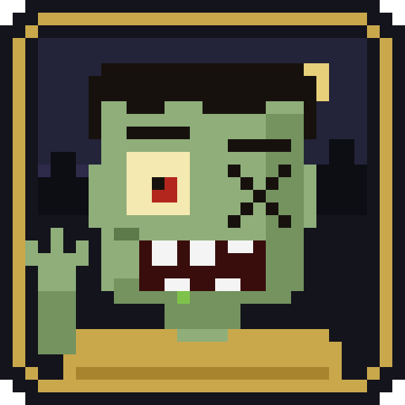
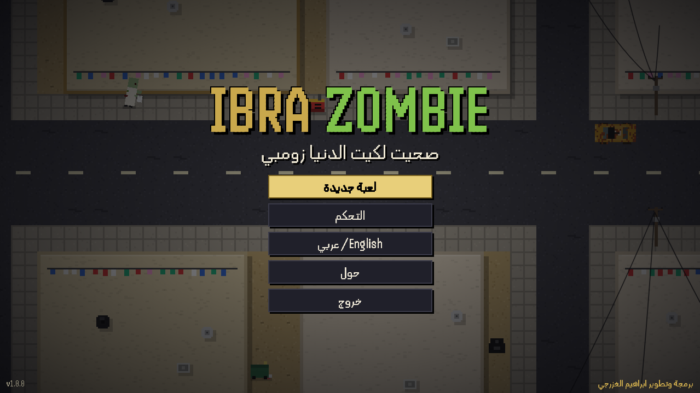
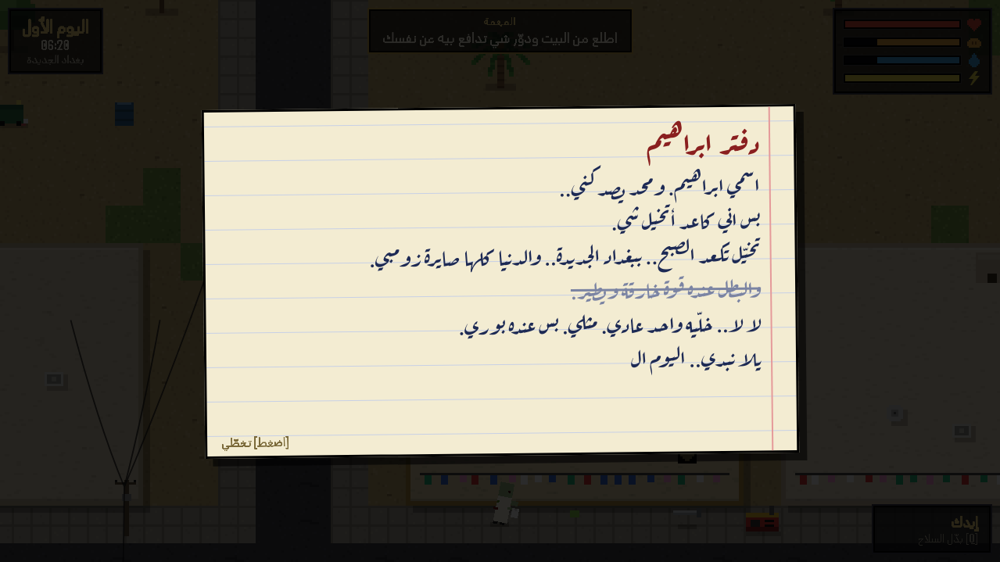
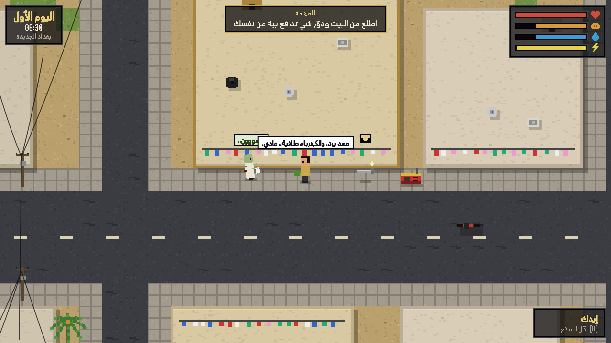
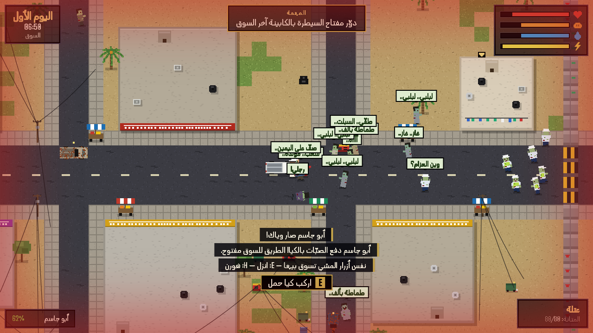
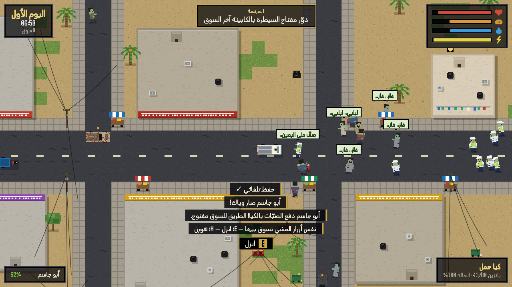
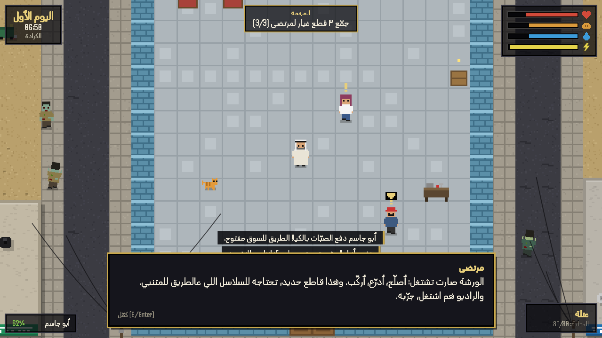
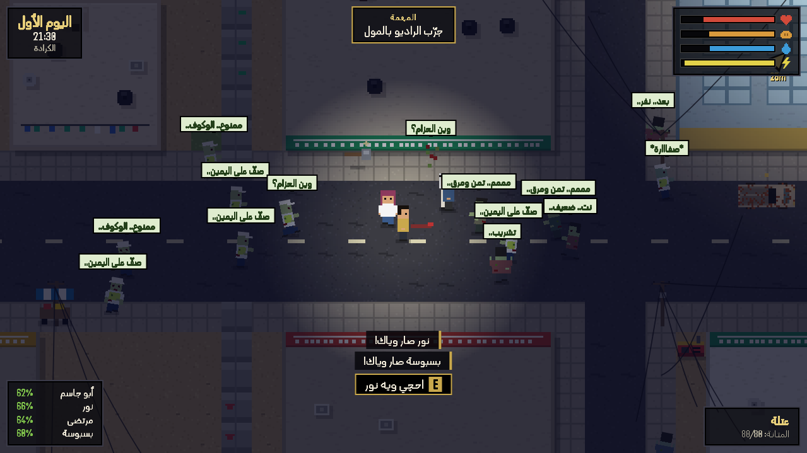
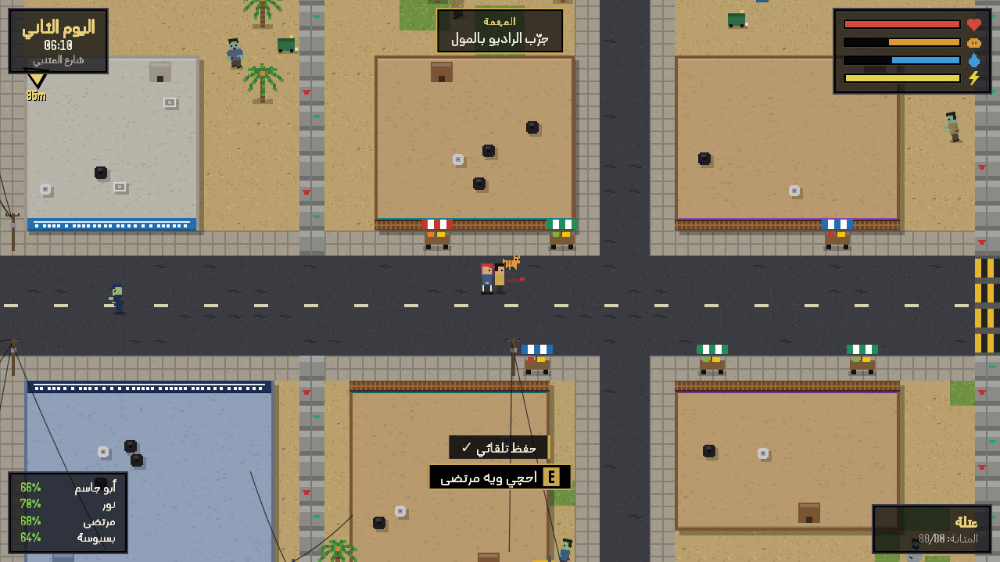
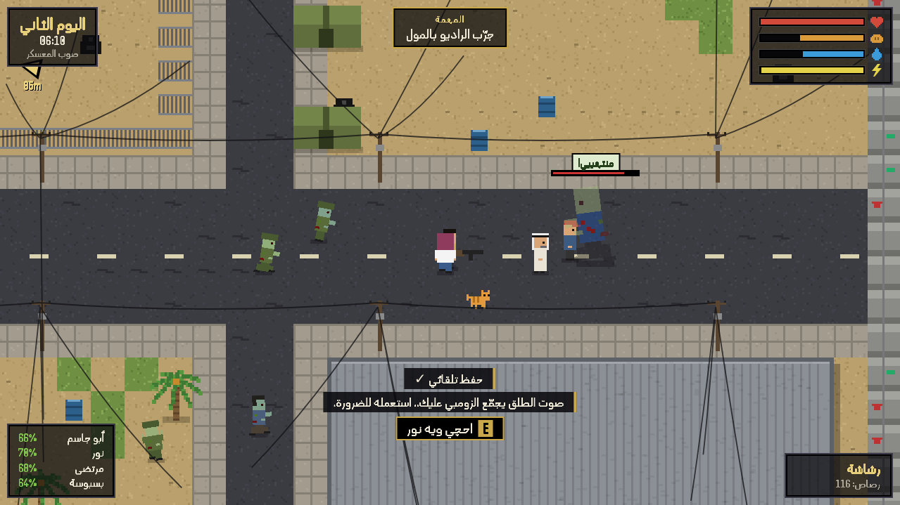

<div align="center">



# IBRA ZOMBIE
### صحيت لكيت الدنيا زومبي

لعبة بقاء بكسل فكاهية تدور أحداثها ببغداد — من فوق، بالأسهم أو WASD والماوس.

**برمجة وتطوير ابراهيم الخزرجي**

</div>



## القصة

واحد كاعد يكتب بدفتره ويتخيّل: يكعد الصبح ببغداد الجديدة ويلكى الدنيا كلها صايرة زومبي.
الزومبيات بطيئة، خطرة، وتضحّك: شرطي مرور بعده يصفّر، بايع يصيح "باكلة"، وأبو المولدة يدفع مولدته.
تطلع من البيت ببوري حديد، تدوّر أكل وماي، تتعرف على ناس — الي يبقى وياك والي يعوفك — تاخذ سيارة وتطوّرها، وتمشي من محلة لمحلة لحد ما تعرف شنو صار.

كل يوم ينكتب بالدفتر: اليوم الأول، الثاني، الثالث... والقصة إلها ثلاث نهايات.

| | |
|---|---|
|  |  |
|  |  |
|  |  |
|  |  |

## المميزات

- **عالم بغدادي بالبكسل**: بيوت طابوق بسطوح عليها خزانات وصحون، أسلاك مولدات، صبّات كونكريتية، سوق، مول الكرادة، شناشيل المتنبي، الجسر والمعسكر.
- **بقاء**: صحة، أكل، ماي، طاقة. ليل ونهار، والليل أخطر.
- **أسلحة واقعية تتطور**: بوري ← عتلة ← ساطور ← مجرفة ← مسدس ← رشاشة. صوت الطلق يجمّع الزومبي.
- **رفاق وثقة**: أبو جاسم، نور، مرتضى، بسبوسة البزّونة وغيرهم. تأكّلهم يبقون، تهملهم يعوفوك.
- **سيارات**: بايسكل، ستوتة، كيا حمل، سايبا، جكسارة مدرّعة — وتدريع وخزان وهورن ومكان ركاب.
- **ملجأ يتطور**: شبابيك، خزان ماي، حديقة، مولدة.
- **حفظ يدوي (F5)** وحفظ تلقائي بالأماكن الآمنة ومن تنام، و**اسم لكل لاعب**.
- **عربي وإنكليزي**.
- **فحص التحديث** عند التشغيل.

## التحكم

| الزر | الوظيفة |
|---|---|
| WASD / الأسهم | الحركة والسياقة (نفس الأزرار) |
| Shift | ركض |
| الماوس | تصويب — الزر الأيسر ضرب/إطلاق — الأيمن (ضغط) امشي باتجاه المؤشر |
| عجلة الماوس | تقريب وتبعيد الكاميرا — C يرجّعها |
| E | تفاعل / اركب / انزل / احچي |
| Q | بدّل السلاح |
| F / X | أكل وشرب سريع / علاج سريع |
| H | هورن |
| I / Tab — M | الحقيبة — الخريطة |
| F5 — F11 — Esc | حفظ — ملء الشاشة — القائمة |

## التنصيب

نزّل `IBRA-ZOMBIE-Setup-x.x.x.exe` من صفحة [الإصدارات](../../releases/latest) وشغّله. (ويندوز 10/11، 64 بت)

## للمطورين

```bash
npm install
npm start          # تشغيل اللعبة
npm run dist       # بناء ملف التنصيب لويندوز داخل dist/
npm run shots      # لقطات شاشة تلقائية من داخل اللعبة
```

اللعبة مبنية بـ Electron و HTML5 Canvas، وكل الرسوم البكسلية تنرسم بالكود (ماكو ملفات صور).

---

## English

**IBRA ZOMBIE — Woke Up to a Zombie World** is a comedic top-down pixel survival game set in Baghdad.
A guy writes a story in his notebook: he wakes up one morning in Baghdad Jadida and everyone has turned into slow, clumsy, oddly committed zombies. Scavenge food and water, upgrade weapons from an iron pipe to a rifle, recruit companions who stay or leave depending on how you treat them, upgrade vehicles from a bicycle to an armored truck, and cross the city to find out what happened. Three endings. Arabic and English.

Download the installer from [Releases](../../releases/latest).

## الحقوق

- برمجة وتطوير **ابراهيم الخزرجي** — Telegram: [t.me/ibraprogram](https://t.me/ibraprogram) — TikTok: [@ibraprogram](https://www.tiktok.com/@ibraprogram)
- الكود برخصة MIT. الخطوط Handjet و Aref Ruqaa برخصة SIL OFL.
